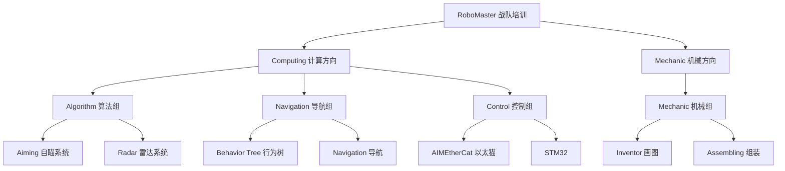

# UNNC AIM 新生培训课程 · 仓库总览

> 本仓库（`aim-rookie-courses`，不带年份）是 UNNC AIM 战队新生培训课程的**总览与整体使用指南**。各学年课程放在独立的 `aim-<学年>-rookie-courses` 仓库中，学年结束后归档。

## 仓库家族

| 仓库 | 状态 | 内容 |
| --- | --- | --- |
| [aim-rookie-courses](https://github.com/unnc-aim/aim-rookie-courses)（本仓库） | 长期维护 | 仓库总览、整体使用指南、学年换届说明 |
| [aim-2627-rookie-courses](https://github.com/unnc-aim/aim-2627-rookie-courses) | **当前学年** | 2026-2027 学年培训课程：计算方向（控制 / 导航 / 算法三平行组）+ 机械方向 |
| [aim-2526-rookie-courses](https://github.com/unnc-aim/aim-2526-rookie-courses) | 已归档 | 2025-2026 学年培训课程（Routes / Contents 分离架构） |

**命名约定**：`aim-<学年>-rookie-courses`，学年取起止年份后两位（`2627` = 2026-2027 学年）。每个学年一个仓库，学年结束后在 GitHub 上归档（Archive），只读不再更新。

## 食用指南

### 第一步：进入当前学年仓库

所有课程内容都在**当前学年**仓库里（见上表，每个学年初会更换）。请先去当前学年仓库的 [README](https://github.com/unnc-aim/aim-2627-rookie-courses/blob/main/README.md) 了解整体结构。

### 第二步：配置本地环境

按当前学年仓库根目录的 [ENV_SETUP.md](https://github.com/unnc-aim/aim-2627-rookie-courses/blob/main/ENV_SETUP.md) 安装 VS Code、Git 等工具，并把仓库 clone 到本地。教程文档会持续更新，`git pull` 即可同步最新内容。

### 第三步：确定专业方向

- **计算方向（Computing）**：适合对编程、算法、电路设计感兴趣的同学。先完成 `01-Python → 02-Linux → 03-Cpp → 04-ROS2` 公共基础，再进入平行分组：
   - **控制组（Control）**：EtherCAT 通信、电机与底盘控制、嵌入式开发 → [学习路线](https://github.com/unnc-aim/aim-2627-rookie-courses/blob/main/Computing/Control/README.md)
   - **导航组（Navigation）**：SLAM 定位建图、路径规划、运动控制 → [学习路线](https://github.com/unnc-aim/aim-2627-rookie-courses/blob/main/Computing/Navigation/README.md)
   - **算法组（Algorithm）**：OpenCV 视觉基础、自瞄 / 雷达系统 → [学习路线](https://github.com/unnc-aim/aim-2627-rookie-courses/blob/main/Computing/Algorithm/README.md)
- **机械方向（Mechanic）**：适合对机械设计、结构分析、制造工艺感兴趣的同学，使用 Inventor 进行 3D 建模 → [学习路线](https://github.com/unnc-aim/aim-2627-rookie-courses/blob/main/Mechanic/README.md)

### 第四步：按路线学习

进入所在方向的组目录，按其 `README.md` 中的学习路径与课程安排推进即可。遇到问题可以在对应仓库提 issue，或直接联系各组负责人。

## 布局演变

### 2526 学年（已归档）：路线 / 内容分离

- `Contents/` 存放课程内容（Python / Linux / Cpp / ROS2 / OpenCV / Mechanic），`Routes/` 按组存放学习路线；
- 计算方向分**算法组**（下辖导航、视觉两个子方向）和**电控组**。

### 2627 学年（当前）：组目录合并 + 三个平行组

- 取消 Routes / Contents 分离，学习路线与课程内容统一放在组目录下（组目录 `README.md` 即入口）；
- **控制、导航、算法三个组平行**，同属 `Computing/`：
   - 电控组更名为**控制组**（Electronic → Control）；
   - **导航**从算法组独立成组；
   - **算法组**聚焦视觉方向（自瞄 / 雷达），原 Vision 路线并入；
- 课程全局编号：公共基础 `01`-`04` 全组必修，其后按开课顺序连续编号（`05-OpenCV`…）。

组级别的迁移对照：

| 2526 | 2627 | 说明 |
| --- | --- | --- |
| `Routes/Computing/Electronic/` | `Computing/Control/` | 电控组更名控制组 |
| `Routes/Computing/Algorithm/Navigation/` | `Computing/Navigation/` | 导航独立成组 |
| `Routes/Computing/Algorithm/Vision/` | `Computing/Algorithm/` | Vision 并入算法组 |
| `Contents/` + `Routes/` | `Computing/<组>/`、`Mechanic/` | 课程与路线合并 |

完整路径级对照表见 [2627 仓库 README](https://github.com/unnc-aim/aim-2627-rookie-courses/blob/main/README.md)。

## 维护者指南：学年换届

每个学年初（约 9 月）执行一次：

1. **建新学年仓库** `aim-<新学年>-rookie-courses`，从上学年仓库复制课程内容；课程内容可按当年教学安排修订，但沿用「组目录 = 路线 + 内容」的布局与课程全局编号约定。
2. **撰写新学年根 README**：说明本学年新变化、目录结构与上学年迁移对照（可参考 [2627 README](https://github.com/unnc-aim/aim-2627-rookie-courses/blob/main/README.md) 的写法），并迁移根目录 `ENV_SETUP.md`（更新其中的克隆地址）。
3. **归档上学年仓库**：GitHub → Settings → Archive repository，归档后不再接受修改。
4. **更新本仓库**：「仓库家族」表格换当前学年指针，把旧学年移入归档行，必要时补充布局演变记录。
5. **组结构调整**（如今年三组平行）只需在新学年仓库内落地，并在本页「布局演变」补一段说明。

仓库命名 / 分支 / commit / 代码格式化规范见 [unnc-aim/.github](https://github.com/unnc-aim/.github) `profile/`；使用 AI 编程助手的队员推荐安装 [aim-common-rules](https://github.com/unnc-aim/aim-common-agentic-skills) skill。

## 相关链接

- [unnc-aim 组织主页](https://github.com/unnc-aim)
- [战队规范（.github profile）](https://github.com/unnc-aim/.github)
- [AI 规范 skill（aim-common-agentic-skills）](https://github.com/unnc-aim/aim-common-agentic-skills)
- [GitHub Education 免费申请教程（aim-tutorial）](https://github.com/unnc-aim/aim-tutorial)

## 维护人员名单

- [Robert He](https://github.com/hnrobert)
- [Xiaoyan Gong](https://github.com/Calc1te)
- [Animex77](https://github.com/Animex77)
- [lv_xin](https://github.com/lvxin1024)
- [HappyDog](https://github.com/HappyDog060713)
- [AnthonyBvvd](https://github.com/AnthonyBvvd)
